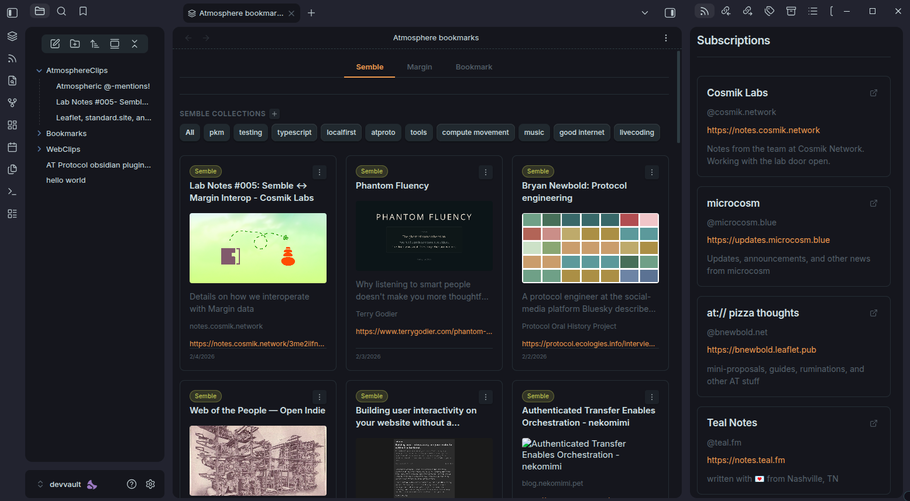
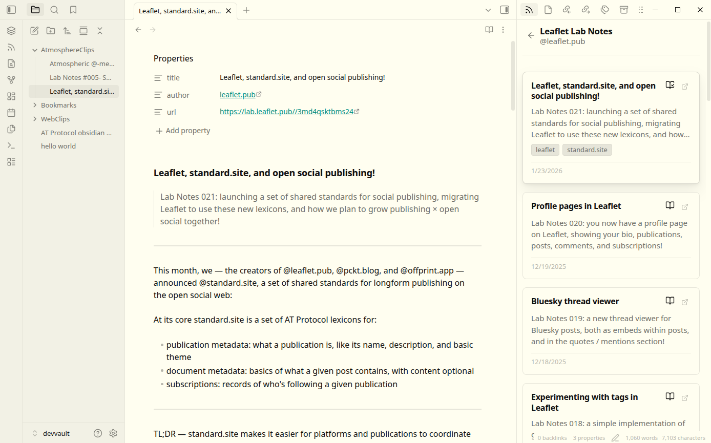

# Clipper

Obsidian plugin for AT Protocol: browse and manage bookmarks, publish notes to
[standard.site](https://standard.site/), and read the publications you follow.

Surf the atmosphere from the coziness of your vault.




A fork of [treethought/obsidian-atmosphere](https://github.com/treethought/obsidian-atmosphere),
maintained at [alexeiaccio/obsidian](https://github.com/alexeiaccio/obsidian).

## Features

### Bookmarks

Read and manage bookmarks from AT Protocol platforms:

- [Semble](https://semble.so) (`network.cosmik.*`) — collections, cards, notes
- [Margin](https://margin.at) (`at.margin.*`) — bookmarks with collections and tags
- [Kipclip](https://kipclip.com) and community bookmarks (`community.lexicon.bookmarks.*`)
- GitHub stars and Arc tabs, read into the same view

Filter by collection or tag, add cards to collections, search across sources.

### Publishing

Publish Obsidian notes to a standard.site publication ([leaflet.pub](https://leaflet.pub),
[pckt.blog](https://pckt.blog)). The note is converted to the format the
publication expects, published, and its properties get the publication URL and
AT-URIs.

### Reading

The feed lists your subscribed publications; open one to browse its documents and
clip any of them into the vault.

### Lenses

Canvas views built from the same data:

- **Group bookmarks by meaning** — asks TypeSafe's Jev to file each saved link into
  one of your own topics (collections, tags, repeated sites), then lays the groups
  out on the active canvas.
- **Draw connections on canvas** — connection endpoints from your records.
- **Write link queue for the map** — a queue for the tldraw map lens.

## Install

There is no release archive to fetch — build it and copy the artifacts into the
vault:

```bash
git clone https://github.com/alexeiaccio/obsidian.git
cd obsidian
pnpm install
pnpm build
cp {main.js,manifest.json,styles.css} <vault>/.obsidian/plugins/obsidian-clipper/
```

Then enable **Clipper** in **Settings → Community plugins**.

The plugin imports `@eoa/*` (the Effect-native AT Protocol core, identity, OAuth
and XRPC). Those are not on npmjs: `.npmrc` points the `@eoa` scope at
`https://npm.accio.blue`, an npm-compatible index over the releases published on
the org PDS. Nothing else to configure — `pnpm install` treats them like any other
dependency, and `effect` comes out at one version (`4.1.1`).

## Sign in

Two mechanisms, both in **Settings → Clipper**:

- **Browser (OAuth).** Enter your handle, approve in the browser, and come back.
  The plugin runs as a native loopback client — nothing is published and no
  metadata lives on someone else's domain. AT Protocol treats loopback clients as
  untrusted, so expect a re-login about once a day.
- **App password.** Handle (or email) plus an app password from
  [bsky.app → Settings → App passwords](https://bsky.app/settings/app-passwords).
  The credential is stored in this vault's plugin data and can be revoked there.
  No expiry, no browser round trip.

## Commands

| Command | Description |
|---------|-------------|
| **Open bookmarks** | The bookmarks view: Semble, margin.at, bookmarks, GitHub, Arc |
| **Open feed** | Subscribed standard.site publications |
| **Publish note** | Publish the active note to a standard.site publication |
| **Group bookmarks by meaning on canvas** | File saved links into topics on the active canvas |
| **Draw connections on canvas** | Draw the connection graph on the active canvas |
| **Write link queue for the map** | Write the queue the tldraw map lens reads |
| **Read source of this note** | Open the note's `url` frontmatter in the reader |

Commands with a canvas in the name need a `.canvas` file as the active view.

## Settings

| Setting | Description |
|---------|-------------|
| Handle / app password | Sign-in; see above |
| Clip directory | Where clipped documents go (default `clips`) |
| Note template, templates by source | Markdown template for clipped notes |
| Relations: direction, types, resolved only, limit, link clipped notes | How clipped notes are linked to each other |
| Bookmarks: sources | Which sources the bookmarks view reads |
| GitHub login / token / max items | GitHub stars as a source |
| Arc max items | Arc tabs as a source |
| Map: tldraw file | The file the map lens targets |
| Meaning: topics | Optional comma-separated topics; collections, tags and repeated sites are used when empty |
| Meaning: TypeSafe API key | Used by **Group bookmarks by meaning** (Jev), stored in this vault's plugin data |

## Network use

Repository records are read through `bsky.social`, which serves the same public
data and is reachable from more networks than a bare `*.bsky.network` PDS host.
Writes — publishing, tagging, collections — go to the PDS that hosts your account,
since they need your signature. Other sources (margin.at, standard.site
publications, GitHub) are read where they live.

Article pages for the **Source reader** are fetched directly. When that fails, or
takes longer than eight seconds — a proxy, a host that ignores non-browser
clients, a page that only renders in a browser — the reader falls back to
[defuddle.md](https://defuddle.md), which fetches the page and returns its
Markdown. That is the one request that leaves your repository and the page itself
for a third party, and it runs only when the direct read cannot. The other third
party that sees your content is TypeSafe, and only when you run **Group bookmarks
by meaning** with a key set: it receives the saved links' titles, descriptions,
URLs and tags plus your topic candidates. No telemetry.

## License

MIT — see [LICENSE](./LICENSE). Original work © 2025 treethought.
